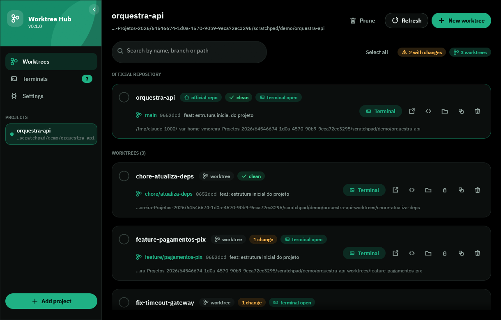
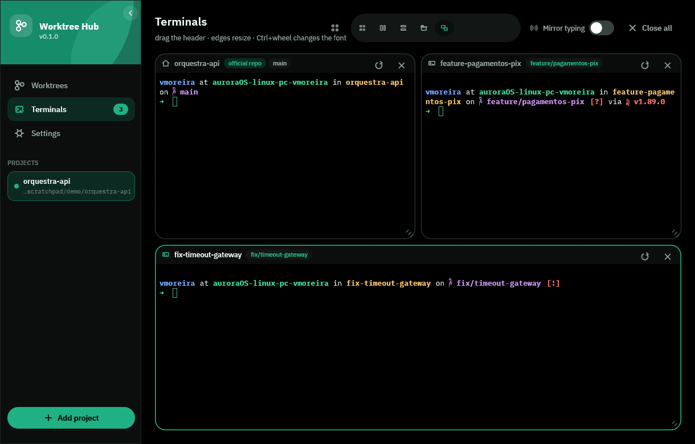

<div align="center">

# Worktree Hub

**Orquestração gráfica de git worktrees — listar, criar, remover e abrir vários
terminais ao mesmo tempo, com poucos cliques.**

Rust · egui · AppImage (Linux) · .exe (Windows)

[](https://github.com/vitormoreiradesenvolvedor/worktree-hub/actions/workflows/ci.yml)
[](https://github.com/vitormoreiradesenvolvedor/worktree-hub/actions/workflows/release.yml)

</div>



---

## O que ele faz

- **Lista** todas as worktrees de cada repositório com branch, SHA, último commit,
  quantidade de alterações e quanto está à frente/atrás do upstream.
- **Cria** worktree nova em um diálogo: nome da branch, base, pasta sugerida
  automaticamente e as opções avançadas do `git worktree add` (`--detach`,
  `--force`, `-B`, `--track`, `--no-checkout`) — sempre mostrando o comando exato
  que vai rodar.
- **Remove** worktree (com `--force` quando há alterações) e, se quiser, apaga a
  branch junto. Também faz `prune` dos registros órfãos e `lock`/`unlock`.
- **Abre terminal** embutido em qualquer worktree, ou no terminal/editor/gerenciador
  de arquivos do sistema.
- **Escolhe o editor na hora**: "Abrir editor" mostra os editores e IDEs que o
  menu de aplicativos do sistema conhece — VS Code, Antigravity, Cursor, Zed,
  IntelliJ, Kate… — com o ícone de cada um. Dá para marcar "usar sempre este" e
  ele vira o comando salvo em Ajustes.
- **Multiterminal estilo terminator**: marque várias worktrees nos checkboxes e
  abra todas em painéis lado a lado (grade, colunas, linhas, abas ou **livre**),
  com **espelhamento de digitação** para rodar o mesmo comando em todas de uma vez.
- **Comandos salvos**: até três botões com nome e comando próprios, guardados na
  configuração, que disparam o comando em todos os painéis de uma vez.
- **Mouse nos programas de tela cheia**: cliques, arrastos e roda são
  entregues a quem pediu o mouse (`claude`, `htop`, `vim`, `lazygit`…), então o
  ponteiro vale onde está — rolar sobre a conversa rola a conversa, fechar um
  painel do programa fecha aquele painel, e as divisões dele dão para arrastar.
  Segurando **Shift** o mouse volta a ser do terminal, para selecionar texto.
- **Imagens no terminal**: o painel entende o protocolo gráfico do kitty, então
  `fastfetch --logo-type kitty`, `kitten icat` e companhia desenham a figura no
  meio do texto, e ela rola junto com o histórico. Os painéis ainda ganham um
  `fastfetch` de atalho no início do `PATH` que já passa `--logo-type kitty`, de
  modo que a figura aparece sem argumento nenhum — nos outros terminais nada
  muda, porque o atalho só existe dentro do Worktree Hub. Quando o shell é o
  bash, o painel o inicia com um `--rcfile` que carrega o seu `~/.bashrc` e só
  então recoloca o atalho na frente do `PATH`, porque arquivos de inicialização
  costumam reconstruir o `PATH` do zero.
- **Layout livre com encaixe**: arraste o cabeçalho de um painel sobre outro e
  solte na borda onde ele deve entrar — os vizinhos se reacomodam sozinhos e a
  área nunca fica com buraco. Soltando perto da borda da área, o painel ocupa
  metade inteira (coluna de altura cheia ou linha de largura cheia). As divisões
  entre painéis são arrastáveis, cada painel tem botão de maximizar e `F11` joga
  tudo em tela cheia.
- **Separa o repositório oficial dos worktrees**: a lista tem uma seção para a
  pasta do repositório e outra para os worktrees criados a partir dele, e o
  cabeçalho de cada painel de terminal diz qual é qual.
- **Ajustes com prévia**: em telas largas a tela de ajustes ganha uma segunda
  coluna com uma maquete que mostra na hora a cor de destaque, as fontes e as
  duas transparências, além dos atalhos e de onde ficam os arquivos desta
  instalação.
- **Se ajusta a você**: cinco cores de destaque (verde pedra, cinza, azul escuro,
  amarelo, roxo), tema claro/escuro, quatro fontes de interface e cinco de
  terminal, tamanho da interface, transparência da janela e **transparência real
  do terminal** (o fundo do painel é apagado do framebuffer, então o que aparece
  é a sua área de trabalho), barra lateral recolhível com animação e interface em
  **inglês, português, russo e chinês**.



## Instalar

Os binários saem prontos do GitHub Actions, em
[releases](https://github.com/vitormoreiradesenvolvedor/worktree-hub/releases):

- [`latest`](https://github.com/vitormoreiradesenvolvedor/worktree-hub/releases/tag/latest)
  — pré-release reconstruída a cada commit na `master`, sempre no estado mais
  recente do código.
- releases com número de versão (`v0.1.0`, …) — os builds estáveis, publicados
  quando uma tag `v*` é criada.

### Linux (AppImage)

```bash
chmod +x Worktree_Hub-*-x86_64.AppImage
./Worktree_Hub-*-x86_64.AppImage
```

### Windows

Baixe `worktree-hub.exe` do release e execute. Não precisa instalar nada.

### Compilar do código

```bash
cargo build --release          # binário em target/release/worktree-hub
./scripts/build-appimage.sh    # dist/Worktree_Hub-<versão>-x86_64.AppImage
./scripts/build-windows.sh     # .exe via cargo-xwin ou mingw-w64
```

O único requisito em tempo de execução é o `git` no PATH.

## Usar

1. **Adicionar projeto** na barra lateral e escolher a pasta do repositório.
2. A lista mostra o **repositório oficial** em uma seção e os **worktrees** em outra.
3. Marque os checkboxes das worktrees que interessam e clique em
   **Abrir multiterminal** — um painel por worktree, cada um com um shell de verdade
   já posicionado na pasta certa.

### Linha de comando

```bash
worktree-hub                                  # abre normalmente
worktree-hub --terminals /caminho/a /caminho/b  # já abre os painéis dessas worktrees
worktree-hub --dump-icon icone.png 512        # exporta o ícone do app
```

### Atalhos

| Atalho | Ação |
|---|---|
| `Ctrl+N` | novo worktree |
| `Ctrl+R` / `F5` | atualizar a lista (na tela de terminais, `Ctrl+R` é do shell) |
| `Ctrl+Shift+T` | abrir multiterminal da seleção |
| `Ctrl+Shift+W` | fechar o painel em foco |
| `Ctrl+Shift+B` | ligar/desligar espelhamento de digitação |
| `F9` | recolher/abrir a barra lateral |
| `F11` | tela cheia (também no botão ao lado do nome, em qualquer tela) |
| `Ctrl+C` | interrompe o programa do terminal (SIGINT), como em qualquer terminal |
| `Ctrl+Shift+C` / `Ctrl+Shift+V` | copiar / colar dentro do terminal |
| `Ctrl+Shift+↑` `↓` `PageUp` `PageDown` | rolar o histórico do terminal |
| `Ctrl` + roda do mouse | tamanho da fonte do painel sob o cursor |
| `Ctrl+1` `Ctrl+2` `Ctrl+3` `Ctrl+4` | worktrees / terminais / ajustes / sobre |

Dentro de um painel, o mouse seleciona texto (duplo clique = palavra, triplo =
linha, `Alt` = seleção em bloco; arrastar além da borda rola junto), a roda e a
**barra de rolagem da direita** percorrem o histórico e `Ctrl`+roda muda o
tamanho da fonte só daquele painel. No layout **Livre**, arraste o cabeçalho
sobre outro painel e solte na metade de cima, de baixo, da esquerda ou da
direita para encaixar ali (soltar no meio troca os dois de lugar); arraste as
divisões para redistribuir o espaço e use o botão de maximizar (ou dois cliques
no cabeçalho) para um painel ocupar tudo. **Organizar** redivide em partes iguais.

## Como é feito

| Camada | Implementação |
|---|---|
| Interface | `eframe`/`egui` (backend OpenGL/`glow`) com um design system próprio: cartões arredondados, botões pílula, verde pedra `#1FB184` sobre fundo preto, animações de transição, e as fontes embutidas IBM Plex Sans / Inter / Source Sans 3 / Fira Sans e IBM Plex Mono / JetBrains Mono / Fira Code / Source Code Pro / Cascadia Mono |
| Painéis | árvore de tiling (`src/ui/tiles.rs`): cada divisão guarda direção e proporção, então mover ou fechar um painel sempre deixa a área inteira preenchida |
| Idiomas | tabela estática ordenada em `src/i18n.rs` (busca binária, idioma atual em um atômico); chinês usa uma fonte CJK do sistema, que o app avisa quando não existe |
| Git | chamadas ao `git` real (`worktree list --porcelain`, `status --porcelain=v2`, `for-each-ref`), sempre fora da thread de UI |
| Terminal | um PTY por painel via `portable-pty` (ConPTY no Windows) com emulação VT do `alacritty_terminal`, renderizado célula a célula no egui |
| Imagens | sequências do protocolo gráfico do kitty são lidas antes do emulador, decodificadas (PNG ou RGBA, com ou sem zlib) e desenhadas na linha do histórico onde chegaram |
| Configuração | JSON em `~/.config/worktree-hub/config.json` |

Sem Electron, sem webview: um binário só.

## Desenvolvimento

```bash
cargo test            # 101 testes: parsing do git, atalhos de terminal, imagens, menu de apps, tiling, i18n, UI headless
cargo clippy --all-targets -- -D warnings
cargo fmt --all
```

Os testes de integração rodam `git` de verdade em repositórios temporários e
a suíte `tests/ui_headless.rs` executa a interface inteira quadro a quadro
(incluindo PTYs reais) sem abrir janela.

## Licença

Código sob MIT (veja `LICENSE`).

As fontes embutidas são de terceiros, sob SIL Open Font License 1.1 (cada
licença está em `assets/fonts/`):
[IBM Plex Sans e IBM Plex Mono](https://github.com/IBM/plex),
[Inter](https://github.com/rsms/inter),
[JetBrains Mono](https://github.com/JetBrains/JetBrainsMono),
[Source Sans 3](https://github.com/adobe-fonts/source-sans),
[Fira Sans](https://github.com/mozilla/Fira),
[Fira Code](https://github.com/tonsky/FiraCode),
[Source Code Pro](https://github.com/adobe-fonts/source-code-pro) e
[Cascadia Mono](https://github.com/microsoft/cascadia-code).
